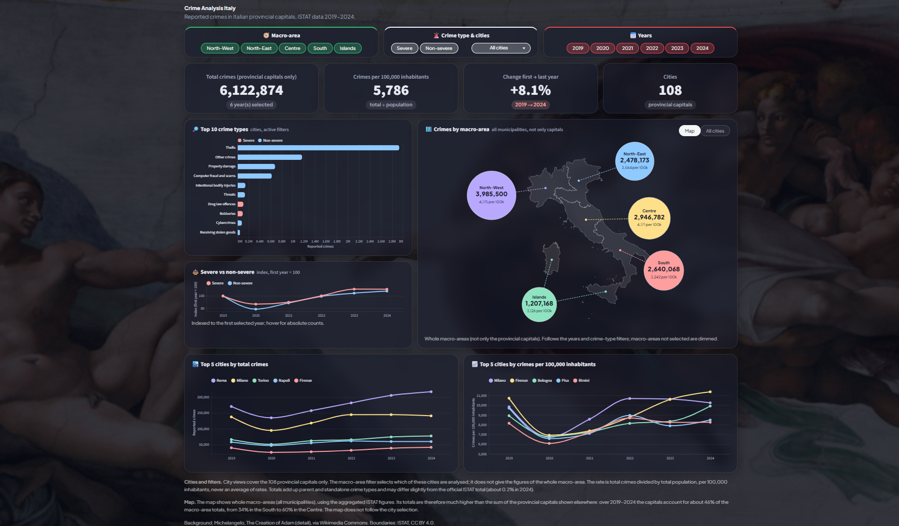

# Crime Analysis Dashboard: Italy 2019-2024

An interactive dashboard on Italian crime statistics, built from ISTAT open data with **Snowflake**, **dbt** and **Streamlit**. It compares territories on crimes per 100,000 inhabitants, separates severe from non-severe crimes, and documents every data decision along the way.

**Live app**: https://crime-analysis-italy.streamlit.app



## What you can explore
- Total crimes, crimes per 100,000 inhabitants and the change from the first to the last year, for any combination of macro-area, city, severity and years.
- Top 10 crime types and a severe vs non-severe trend (index, first year = 100).
- A map of the five macro-areas, or a sortable table of the 108 provincial capitals with CSV export.
- Top 5 cities by total crimes and by crimes per 100,000 inhabitants.

## Architecture
```
ISTAT CSV → Python ingestion → Snowflake raw tables → dbt (seeds, staging, marts) → Streamlit
```
- **ELT, not ETL**: Python only parses the CSVs. Severity flags, crime-code hierarchy, territorial levels, macro-area mapping and English crime names are all defined in dbt, where they are tested and documented.
- **Raw layer**: the ISTAT downloads, the scripts that parse them and the cleaned CSVs loaded into the Snowflake raw tables are all in the repository (`data/`, `scripts/`).
- **Models**: `stg_crimes`, `stg_population` → `fct_crimes`, `dim_areas`, `dim_crimes`. Seeds: crime classification (56 codes), city-to-macro-area mapping (108 cities), English crime names (56).
- **54 dbt tests**: keys, not-null, relationships, unique grain, and tolerance-based reconciliation between territorial levels.
- **Two ways to read the data**: in development the app queries Snowflake live. The public deployment has no warehouse credentials and reads `app/snapshot/`, CSV files with the results of the same three queries (`app/queries.py`), exported with `scripts/04_export_app_snapshot.py`.
- **No credentials in code**: the app reads Streamlit secrets, dbt reads its local profile and an environment variable. Changing database means changing configuration values only.

## Data decisions
- **Parents and children**: ISTAT crime codes are hierarchical (for example theft contains vehicle theft). Only parent and standalone codes are summed, so nothing is counted twice. The result is about 0.2% below ISTAT's own total.
- **Rates are never averaged**: crimes and population are summed first, then the rate is recomputed.
- **Cities are the 108 provincial capitals**: the ISTAT crime dataset has no data for the other ~7,800 municipalities. They account for about 46% of national crimes, and the app says so.
- **Cities vs macro-areas**: the map shows full macro-area figures, while the city views cover capitals only. The difference is stated in the app notes.
- **Reconciliation**: macro-areas match Italy within 0.05%; regions match macro-areas within 0.1%. Province totals do not add up to regional totals, probably because ISTAT computes them independently; this is documented, not hidden.
- **Crime names** are translated to English in dbt (a seed); the original Italian names are kept.

More detail in [`PROJECT_DOCUMENTATION.md`](PROJECT_DOCUMENTATION.md) and [`IMPLEMENTATION_NOTES.md`](IMPLEMENTATION_NOTES.md).

## Run it yourself
1. Create a Python 3.13 virtual environment and install `scripts/requirements.txt` and `app/requirements.txt`.
2. The ISTAT downloads and the cleaned CSVs are already in `data/` (see `data/README.md`). To regenerate the cleaned files, run `scripts/01_clean_delitti.py` and `scripts/02_clean_popolazione.py`.
3. Load the two cleaned CSVs into Snowflake raw tables (an automated loading script is planned).
4. Configure your dbt profile (password from the `SNOWFLAKE_PASSWORD` environment variable) and `.streamlit/secrets.toml` with your own Snowflake details.
5. From `crime_analysis/`: `dbt seed && dbt run && dbt test`.
6. From the repository root: `streamlit run app/streamlit_app.py`. With Snowflake credentials in `.streamlit/secrets.toml` it queries Snowflake; without them it reads `app/snapshot/`. To refresh the snapshot after a data update: `python scripts/04_export_app_snapshot.py`.

## Using a different database
No connection detail is written in the code. To point the project at another Snowflake account or database, change the values in `.streamlit/secrets.toml` (app) and in your dbt profile (dbt), set `SNOWFLAKE_PASSWORD`, reload the raw tables, run `dbt seed && dbt run && dbt test` and re-export the app snapshot with `scripts/04_export_app_snapshot.py`. The database and raw schema read by dbt come from the profile and the optional `RAW_SCHEMA` variable. Warehouse-specific SQL lives in dbt macros, so a different warehouse also needs only another dbt adapter and a new connection function in the app.

## Data sources and credits
- Crime and population data: [ISTAT](https://www.istat.it), licensed under [CC BY 4.0](https://creativecommons.org/licenses/by/4.0/). The raw files in `data/` are ISTAT downloads. The cleaned files in `data/` and the files in `app/snapshot/` are derived from them: the cleaning, classification and aggregation are this project's own work, not official ISTAT figures. ISTAT is not affiliated with this project and does not endorse it.
- **Licensing**: the MIT License covers the code in this repository only. The ISTAT data and the data derived from it keep their own licence (CC BY 4.0), which requires attribution and an indication of changes.
- Boundaries: ISTAT, via [openpolis/geojson-italy](https://github.com/openpolis/geojson-italy), CC BY 4.0.
- Background: Michelangelo, _The Creation of Adam_ (public domain, via Wikimedia Commons).
